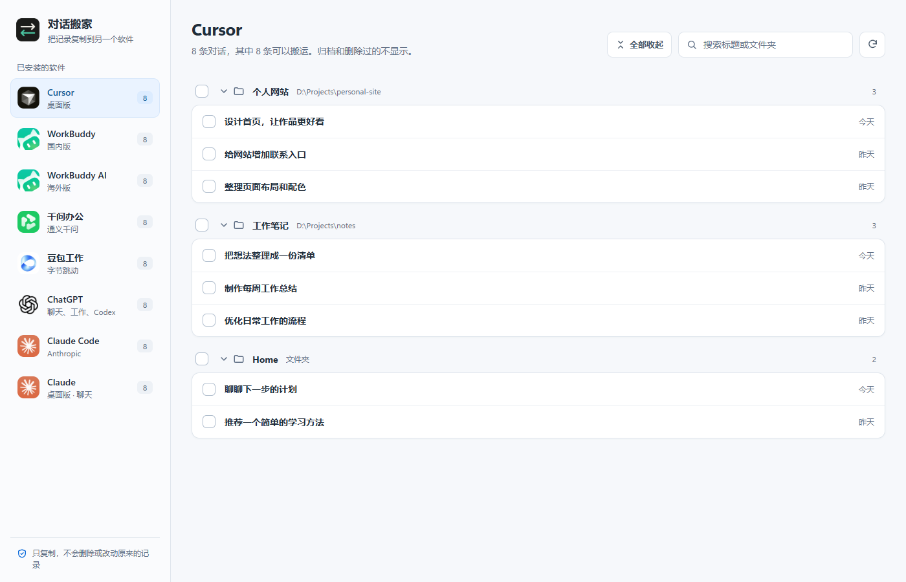
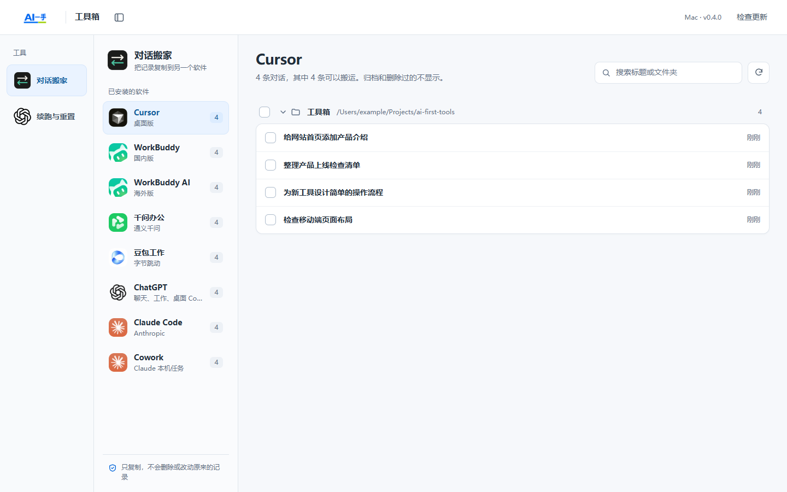

# AI一手 · 工具工作台

把好用的 AI 小工具放在一起。打开一个窗口，点一下就能用。

当前内置 **对话搬家**：把支持的 AI 软件中的对话记录复制到另一个软件，原记录保留。

*界面使用合成示例记录，不包含真实用户对话。*

## 下载安装

**Windows 10 / 11 提供安装版与免安装版；Mac 提供独立 DMG 预览版。**

### Mac 版

**[⬇ Mac 预览版下载（preview.8 自动更新提醒修复版）](https://github.com/feifeigong/ai-first-tools/releases/tag/v0.4.0-macos-preview.8)**

苹果 M 系列选 `macos-arm64.dmg`，Intel Mac 选 `macos-x86_64.dmg`。打开 DMG，拖到「应用程序」，之后直接打开，不需要源码或开发环境。

有新版会自动出现 **「下载并更新」**，点一次即可下载、校验、更新并重新打开。组件就绪后约两秒检查，持续打开每十分钟补查，返回窗口或网络恢复时也会补查（有节流及失败退避）。初始化暂时失败会自动恢复，已发现的可信更新不会因临时断网消失。preview.1/2 需要最后一次手动替换到本版；preview.3 及之后可软件内升级，旧版没提醒时先点一次「检查更新」。保留完整长对话分页修复。能否连接 GitHub 仍取决于本机网络。

*共享界面的浏览器布局预览，使用合成记录；不是 Mac 真机截图。*

**Mac 按作者要求未签名、未公证，首次打开可能被拦截，不能承诺零额外操作。** [安装说明](docs/MACOS.md)。目标 macOS 13 及以上，首批检查运行在 macOS 15，旧系统待真机验收。

### 推荐：Windows 安装版

**[⬇ 下载 Windows 安装包 v0.3.8](https://github.com/feifeigong/ai-first-tools/releases/download/v0.3.8/AI-First-Tools-Setup-0.3.8.exe)**

1. 下载上面的安装包，双击打开。
2. 点击「安装」，等它完成。
3. 以后双击桌面的 **AI一手工具工作台** 图标就能使用。

**不用下载源代码，不用 Git，不用 Python，也不用自己安装 .NET。** 安装到当前用户目录，不要求管理员权限。第一次使用若缺少微软 WebView2，安装程序会联网准备它。

安装包暂未购买代码签名证书，Windows 可能提示「未知发布者」。请核对本仓库、版本与校验文件；不放心请先停止安装，不需要关闭杀毒软件或修改系统安全设置。

### 可选：Windows 免安装版

**[⬇ 下载免安装压缩包 v0.3.8](https://github.com/feifeigong/ai-first-tools/releases/download/v0.3.8/AI-First-Tools-Portable-0.3.8-win-x64.zip)**

解压**整个压缩包**，进入文件夹，双击「AI一手工具工作台.exe」。不能只拿走一个 EXE，也不要直接在压缩包里面运行。可以给这个 EXE 创建桌面快捷方式，以后不用再找文件夹。

如果电脑没有 WebView2，优先使用上面的安装版。

## 怎么搬对话

打开工作台 → 点「对话搬家」→ 选择来源软件与记录 → 点「搬到…」→ 选择目标软件及模式 → 选择文件夹 → 确认搬运。

- 自动寻找本机支持的 AI 软件与历史记录；软件需要已安装并产生过记录。
- 项目/文件夹和无目录记录分别展示，文件夹可以收起。
- ChatGPT 的本机 Work / Codex、Claude 的本机 Cowork / Claude Code，分别选择对应模式。
- 只复制对话，不删除原记录；项目文件、附件、登录状态、模型权限和运行环境不会一起搬过去。
- 开始前请备份重要记录，搬完后到目标软件检查标题、正文和文件夹。

## 支持范围

| 类型 | 当前能力 |
| --- | --- |
| Cursor、WorkBuddy、WorkBuddy AI、千问办公 | 支持本机记录搬入/搬出 |
| ChatGPT | 普通云端聊天可读取；**本机 Work / Codex** 可作为目的地 |
| Claude | 普通聊天可读取；**Claude Code / 已初始化的本机 Cowork** 可作为目的地 |
| Antigravity、Cursor CLI、Grok CLI、OpenCode | 本地适配，具体限制见下方说明 |
| 豆包工作、Hermes | 当前界面只支持搬出，不承诺原生搬入 |

**不是每种软件、每个版本都已完成原生界面和继续对话的验收。** “写入后回读通过”不等于附件、工具调用和下一轮对话必定可用。尤其 Antigravity 桌面端的自动重新索引尚未全面验证。

[支持范围与验证边界](docs/SUPPORT.md) · [隐私与数据安全](docs/PRIVACY.md) · [开发与构建](docs/BUILD.md)

## 更新、卸载与反馈

- **Windows 和 Mac 都会自动提醒更新**：有新版时出现「下载并更新」，点一次即可下载、校验、更新并重新打开。也能点击「检查更新」。新工具随工作台一起更新，无需单独添加。
- 安装版自动覆盖更新；免安装版更新原来的整个程序目录。不操作各 AI 软件的对话目录，保留工作台设置。搬运未结束时不会强制停止；下载可取消，网络不通仍能正常使用。
- Windows v0.3.6 及更早需先手动安装一次 v0.3.8；已使用 v0.3.7 的用户可以软件内升级。Mac preview.1/2 需最后一次手动替换到 preview.8；preview.3 及之后可软件内升级。旧版自动提醒没出现时先点一次「检查更新」升级到本版；仓库提交不会直接改写已安装的旧程序。
- 旧版 Mac 搬到本机 Work 后只见尾部、上翻重试的记录：更新到 preview.7 或之后的版本，再从来源重新搬一次，打开新副本；原记录和旧副本保留，不需删数据库。新版完整比较正文并写入可分页历史，原生验证边界见 [Mac 测试记录](docs/MACOS-QA.md)。
- 卸载：Windows「设置 → 应用」中找到「AI一手工具工作台」。卸载不删除各 AI 软件的对话，也不主动删除工作台的用户配置。
- 反馈：[提交问题](https://github.com/feifeigong/ai-first-tools/issues)，附版本、Windows 版本、来源和目标软件即可。**不要贴登录令牌、完整聊天或个人路径。**

[更新原理与发布方法](docs/UPDATES.md)

Mac 会等待搬运结束再更新；Windows 任务未完成时先完成搬运，再按提示重试，不会强停。Mac 未使用 Developer ID/公证，系统安全策略仍可能要求确认。卸载把应用移到废纸篓，不删除 Agent 数据。

## 在 Mac 上继续开发

源码附完整产品背景、架构、构建步骤、验证边界和可交给新 AI 对话的接手说明：

[开发背景](docs/DEVELOPMENT-CONTEXT.md) · [Mac 开发交接](docs/MACOS-HANDOFF.md) · [测试记录](docs/MACOS-QA.md) · [开发约定](AGENTS.md)

## 开源与致谢

工作台和对话搬家在 [Apache-2.0](LICENSE) 下开源。本地迁移引擎基于 [skillsynchq/txcript](https://github.com/skillsynchq/txcript)，包含本项目的适配与修复；修改后的引擎源码位于 `txcript/`，上游来源和修改说明见 [NOTICE](NOTICE)。

第三方依赖遵循各自许可证。软件名称和品牌 Logo 归其权利人所有，展示不代表官方合作或授权；代码许可证不授予第三方商标使用权。
